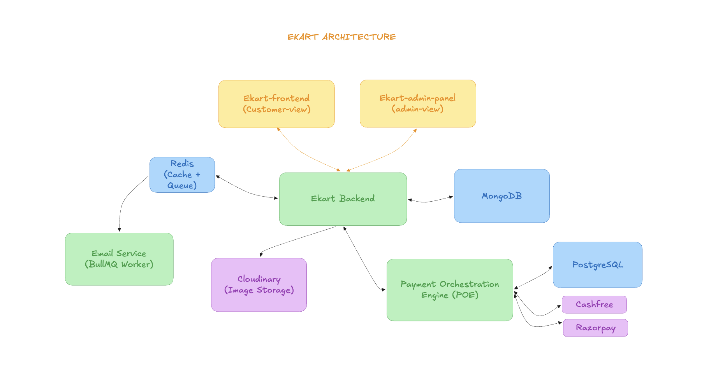

# eKart Backend

The REST API backend for **eKart**, an e-commerce platform. It is built with **Node.js (ES Modules)** and **Express 5**.

This backend handles user accounts, product listings, carts, wishlists, orders, stock, and admin reports. It also connects to a separate **Payment Orchestration Engine (POE)** to process payments through different gateways and handle refunds. It uses **BullMQ** and **Redis** to process background tasks, such as sending emails.

---

## Table of Contents

1. [Highlights](#highlights)
2. [Architecture & Request Flow](#architecture--request-flow)
3. [Interactive API Documentation](#interactive-api-documentation)
4. [Related Repositories](#related-repositories)
5. [Tech Stack](#tech-stack)
6. [Folder Structure](#folder-structure)
7. [Environment Variables](#environment-variables)
8. [Getting Started](#getting-started)
   - [Local Setup](#local-setup)
   - [Database Seeding](#database-seeding)
   - [Docker Setup](#docker-setup)
9. [Role-Based Access Control (RBAC)](#role-based-access-control-rbac)
10. [API Endpoints Reference](#api-endpoints-reference)
   - [Authentication](#authentication)
   - [Users & Profiles](#users--profiles)
   - [Products](#products)
   - [Cart](#cart)
   - [Wishlist](#wishlist)
   - [Orders](#orders)
   - [Payments & Webhooks](#payments--webhooks)
   - [Admin Insights & Analytics](#admin-insights--analytics)
   - [System](#system)
11. [Security & Architecture Practices](#security--architecture-practices)

---

## Highlights

- **Modular Architecture:** Organized feature modules using the Controller-Service-Repository pattern.
- **Payment Integration:** Integrates with the **Payment Orchestration Engine (POE) microservice** to support Razorpay and Cashfree payments and automated refunds.
- **Background Jobs:** Uses BullMQ and Redis to process email notifications asynchronously.
- **Role-Based Access Control:** Supports `user`, `admin`, and `demo-admin` roles with different permissions.
- **Order & Inventory Management:** Server-side price validation, stock checks, and snapshot-based order processing.
- **Media Management:** Handles multiple image uploads using Multer and Cloudinary.
- **Redis Caching & Rate Limiting:** Improves response performance and protects sensitive API routes.
- **Docker Support:** Provides separate Docker configurations for development and production.

---

## Architecture & Request Flow



### Order & Payment Lifecycle

1. **Order Initiation:** The customer places an order. The backend checks the latest prices and stock, then saves an order with a copy of the purchased item details. The order starts as `CREATED`, and the payment starts as `PENDING`.

2. **Payment Creation:** The backend sends a payment request to the **Payment Orchestration Engine (POE)** with an idempotency key. This key helps prevent duplicate payments.

3. **Gateway Dispatch:** POE sends the request to the selected payment gateway, such as Razorpay or Cashfree. The gateway processes the request and returns the session details to POE. POE then sends these details back to the eKart backend, which forwards them to the frontend.

4. **Webhook Verification:** After the payment attempt, the gateway sends a webhook to POE. POE checks the webhook and then calls the eKart backend endpoint `POST /payments/webhook/verify`. The request includes an HMAC signature.

5. **Confirmation & Stock Deduction:** The eKart backend checks the HMAC signature. If it is valid, the backend marks the order as `CONFIRMED`, reduces the available stock, and adds confirmation emails to the background queue.

6. **Automated Cancellation & Refunds:** If a customer cancels a paid order, the backend marks it as `CANCELLED`, adds the stock back, and sends a refund request to POE.

### Background Job Processing

1. Order events, such as confirmation, packing, shipping, delivery, and cancellation, create email jobs.

2. The backend adds these jobs to the **BullMQ** queue (`emailQueue`), which uses Redis to store them.

3. A separate worker reads the jobs and sends the emails in the background. This keeps email work from slowing down API responses.

---

## Interactive API Documentation

The API documentation is built with **Scalar** and OpenAPI (Swagger). It shows the available endpoints and their request and response formats.
- **Live URL:** [https://ekart-backend-s0x7.onrender.com/docs](https://ekart-backend-s0x7.onrender.com/docs)
- **Local URL:** [http://localhost:3000/docs](http://localhost:3000/docs)

---

## Related Repositories

| Repository | Description |
|---|---|
| [eKart Frontend](https://github.com/sn0914r/ekart-frontend) | Customer-facing storefront web app (React / Vite) |
| [eKart Admin Panel](https://github.com/sn0914r/ekart-admin-panel) | Store administration dashboard for managing products, orders, users, and store operations |
| [Payment Orchestration Engine](https://github.com/sn0914r/payment-orchestration-engine) | Payment microservice that integrates Razorpay and Cashfree, handles refunds, and reconciles application database records with gateway transactions |
| [Email Worker Service](https://github.com/sn0914r/email-worker-service) | Dedicated BullMQ queue consumer for email notifications |
---

## Tech Stack

| Category | Technology |
|---|---|
| **Runtime & Language** | Node.js (v22+), ECMAScript Modules (`type: module`) |
| **Framework** | Express.js (v5.x) |
| **Database** | MongoDB (v8) via Mongoose (v9) |
| **Cache & Queues** | Redis (v7) via `ioredis` & `bullmq` |
| **Validation** | Joi |
| **Authentication** | JWT (`jsonwebtoken`), `bcryptjs`, `cookie-parser` |
| **File Storage** | Cloudinary & Multer |
| **Security** | Helmet, CORS, Redis Rate Limiting |
| **Documentation** | Scalar API Reference (`@scalar/express-api-reference`, `swagger-jsdoc`) |
| **Containerization** | Docker, Docker Compose |
---

## Folder Structure

```text
.
├── .dockerignore
├── .env.example
├── .gitignore
├── compose.dev.yml
├── compose.prod.yml
├── Dockerfile
├── eslint.config.mjs
├── package.json
├── README.md
├── docs/
│   ├── architecture.png
│   ├── auth.yml
│   ├── cart.yml
│   ├── insights.yml
│   ├── orders.yml
│   ├── payments.yml
│   ├── products.yml
│   ├── users.yml
│   └── wishlist.yml
├── scripts/
│   └── seedOrders.js
└── src/
   ├── app.js
   ├── server.js
   ├── clients/
   ├── configs/
   ├── constants/
   ├── db/
   │   └── models/
   ├── errors/
   ├── middlewares/
   ├── modules/
   │   ├── auth/
   │   ├── cart/
   │   ├── insights/
   │   ├── order/
   │   ├── payment/
   │   ├── product/
   │   ├── user/
   │   └── wishlist/
   ├── providers/
   ├── queues/
   └── utils/
```

---

## Environment Variables

Create a `.env` file in the project root. Use `.env.example` as the starting point:

```env
# Server
PORT=3000
NODE_ENV=development
CLIENT_ORIGINS=http://localhost:5173,http://localhost:5174
FRONTEND_URL=http://localhost:5173

# Database (MongoDB)
MONGO_URI=mongodb://localhost:27017/ekart

# Cache & Queues (Redis)
REDIS_URL=redis://localhost:6379

# Authentication & Tokens
JWT_ACCESS_TOKEN_SECRET=your_jwt_access_secret_key
JWT_REFRESH_TOKEN_SECRET=your_jwt_refresh_secret_key
JWT_ACCESS_TOKEN_EXPIRES=15m
JWT_REFRESH_TOKEN_EXPIRES=7d

# Cloudinary (Media Storage)
CLOUDINARY_CLOUD_NAME=your_cloud_name
CLOUDINARY_API_KEY=your_cloudinary_api_key
CLOUDINARY_API_SECRET=your_cloudinary_api_secret

# Payment Orchestration Engine (POE)
PAYMENT_SERVICE_API_URL=http://localhost:4000/api/v1
PAYMENT_SERVICE_SECRET=your_poe_shared_hmac_secret
```

---

## Getting Started

### Local Setup

1. **Clone the repository:**

  ```bash
  git clone https://github.com/sn0914r/ekart-backend.git
  cd ekart-backend
  ```

2. **Install dependencies:**

  ```bash
  npm install
  ```

3. **Configure Environment:**

  ```bash
  cp .env.example .env
  # Update .env with your MongoDB, Redis, and Cloudinary credentials
  ```

4. **Start local MongoDB & Redis (or use Docker):**

  ```bash
  docker compose -f compose.dev.yml up ekart-mongodb ekart-redis -d
  ```

5. **Run Development Server:**

  ```bash
  npm run dev
  ```

  The API will be accessible at `http://localhost:3000`.

### Database Seeding

Run this command to add sample orders, addresses, and order history to your database for testing:

```bash
node scripts/seedOrders.js
```

### Docker Setup

#### Development (Hot-reloading with mounted volumes)

```bash
docker compose -f compose.dev.yml up --build
```

#### Production

```bash
docker compose -f compose.prod.yml up -d --build
```

---

## Role-Based Access Control (RBAC)

The backend supports three roles. Each role has different permissions.

| Permission | user | demo-admin | admin |
|---|:---:|:---:|:---:|
| Manage own cart and wishlist | Yes | No | No |
| Place and cancel own orders | Yes | No | No |
| View own refund details | Yes | No | No |
| View admin dashboard and metrics | No | Yes | Yes |
| View products, orders, and users in admin panel | No | Yes | Yes |
| Create, update, and delete products | No | No | Yes |
| Update user roles and account status | No | No | Yes |
| Update order shipping status | No | No | Yes |

`demo-admin` has read-only access to the admin dashboard and its data. The `admin` role can perform the listed management actions.

---

## API Endpoints Reference

### Authentication

| Method | Endpoint | Auth / Role | Description |
|---|---|---|---|
| `POST` | `/auth/register` | Public (Rate-limited) | Register a new user |
| `POST` | `/auth/login` | Public (Rate-limited) | Login and set refresh token cookie |
| `POST` | `/auth/refresh` | Cookie-based | Rotate refresh token and get a new access token |
| `POST` | `/auth/logout` | Authenticated | Revoke refresh token and clear cookies |
| `POST` | `/auth/forgot-password` | Public | Send password reset email |
| `POST` | `/auth/reset-password` | Public | Reset password using verified token |
### Users & Profiles

| Method | Endpoint | Auth / Role | Description |
|---|---|---|---|
| `GET` | `/users/me` *(or `/user/me`)* | Authenticated (`user`) | Get current authenticated user profile |
| `PATCH` | `/users/me` *(or `/user/me`)* | Authenticated (`user`) | Update personal profile details |
| `GET` | `/admin/users` | Admin (`admin`, `demo-admin`) | List/search users with pagination & sorting |
| `GET` | `/admin/users/:id` | Admin (`admin`, `demo-admin`) | Get user profile and account statistics |
| `PATCH` | `/admin/users/:id` | Admin (`admin`) | Update user role and account status |
### Products

| Method | Endpoint | Auth / Role | Description |
|---|---|---|---|
| `GET` | `/products` | Public | List active products with filtering and pagination |
| `GET` | `/products/meta` | Public | Aggregate catalog filters (categories, price range) |
| `GET` | `/products/colors` | Public | Get available product color variants |
| `GET` | `/products/:id` | Public | Get product details by ID |
| `GET` | `/admin/products` | Admin (`admin`, `demo-admin`) | List all products (including inactive/drafts) |
| `GET` | `/admin/products/:id` | Admin (`admin`, `demo-admin`) | Get detailed product data for admin |
| `POST` | `/admin/products` | Admin (`admin`) | Create a new product with image uploads |
| `PATCH` | `/admin/products/:id` | Admin (`admin`) | Update an existing product |
| `DELETE` | `/admin/products/:id` | Admin (`admin`) | Delete a product |
### Cart

| Method | Endpoint | Auth / Role | Description |
|---|---|---|---|
| `GET` | `/cart` | Authenticated (`user`) | Retrieve customer cart with pricing totals |
| `POST` | `/cart/add` | Authenticated (`user`) | Add an item and color variant to cart |
| `PATCH` | `/cart/increase` | Authenticated (`user`) | Increment item quantity |
| `PATCH` | `/cart/decrease` | Authenticated (`user`) | Decrement item quantity |
| `DELETE` | `/cart/remove/:id` | Authenticated (`user`) | Remove a specific item from cart |
| `DELETE` | `/cart/clear` | Authenticated (`user`) | Clear entire cart |
### Wishlist

| Method | Endpoint | Auth / Role | Description |
|---|---|---|---|
| `GET` | `/wishlist` | Authenticated (`user`) | Retrieve customer wishlist |
| `POST` | `/wishlist` | Authenticated (`user`) | Add item to wishlist |
| `DELETE` | `/wishlist/:productId` | Authenticated (`user`) | Remove item from wishlist |
| `DELETE` | `/wishlist` | Authenticated (`user`) | Clear entire wishlist |
### Orders

| Method | Endpoint | Auth / Role | Description |
|---|---|---|---|
| `POST` | `/orders` | Authenticated (`user`) | Place order with snapshot validation |
| `GET` | `/orders` | Authenticated (`user`) | List current user's orders |
| `GET` | `/orders/:id` | Authenticated (`user`) | Get order details and progress timeline |
| `PATCH` | `/orders/:id` | Authenticated (`user`) | Cancel an order (triggers refund if paid) |
| `GET` | `/orders/:id/refunds` | User / Admin | Get POE refund details for the order |
| `GET` | `/admin/orders` | Admin (`admin`, `demo-admin`) | List all store orders with filters and sorting |
| `GET` | `/admin/orders/:id` | Admin (`admin`, `demo-admin`) | Get detailed order view for admin |
| `PATCH` | `/admin/orders/:id` | Admin (`admin`) | Update shipping status (`PACKED`, `SHIPPED`, etc.) |
### Payments & Webhooks

| Method | Endpoint | Auth / Role | Description |
|---|---|---|---|
| `POST` | `/payments/initiate` | Authenticated (`user`) | Initiate payment session via POE |
| `POST` | `/payments/webhook/verify` | POE Webhook | Webhook endpoint verified with HMAC signature |
### Admin Insights & Analytics

| Method | Endpoint | Auth / Role | Description |
|---|---|---|---|
| `GET` | `/admin/dashboard` | Admin (`admin`, `demo-admin`) | Store overview KPIs (revenue, orders, low stock) |
| `GET` | `/admin/analytics` | Admin (`admin`, `demo-admin`) | Sales & order volume time-series analytics |
### System

| Method | Endpoint | Auth / Role | Description |
|---|---|---|---|
| `GET` | `/health` | Public | System health check (`{ success: true }`) |
| `GET` | `/docs` | Public | Scalar interactive API documentation |
---

## Security & Architecture Practices

- **Server-Side Validation:** Calculates prices, taxes, and cart totals on the server.
- **Refresh Token Rotation:** Uses HTTP-only cookies and refresh token rotation with family invalidation.
- **Idempotency:** Prevents duplicate payment and refund requests using unique idempotency keys.
- **Webhook Security:** Verifies POE webhooks using HMAC-SHA256 signatures.
- **Rate Limiting:** Uses Redis-based sliding window rate limiting to protect sensitive routes.
- **Centralized Error Handling:** Uses a custom `AppError` class for consistent error responses.
